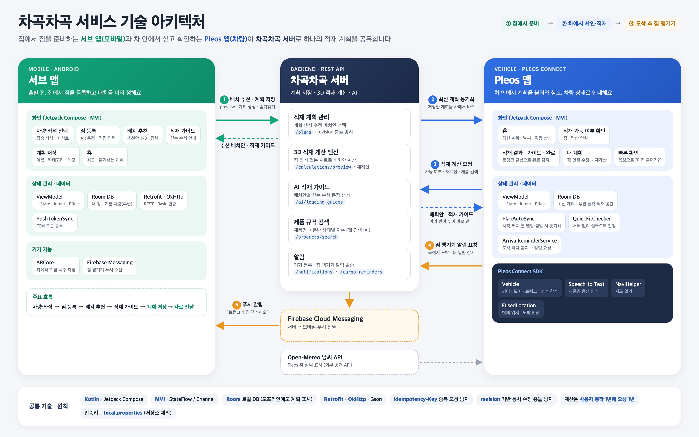
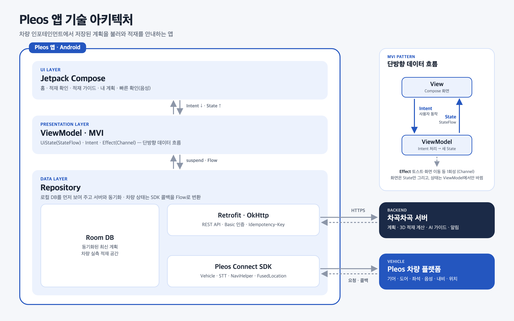

# 차곡차곡 — Pleos 앱 (차량)

> 차 안에서 저장한 적재 계획을 불러와 짐을 싣고, 차량 상태에 맞춰 안내하는 Pleos Connect 앱.
> 모바일 **서브 앱**에서 만든 계획을 차곡차곡 서버로 받아 씁니다.

현대자동차 Pleos Connect 공모전 출품작 **차곡차곡**의 차량용 앱입니다. 1차 기준 차량은 **디 올 뉴 투싼 하이브리드(5인승 SUV)** 입니다.



## 주요 기능

| 기능 | 설명 |
|---|---|
| 홈 | 가장 최근 계획 하나, 날씨, 차량 상태(기어·트렁크)를 보여 줍니다. 주행 중 서비스라 계획은 최신 1개만 다룹니다. |
| 적재 가능 여부 확인 | 짐(제품명 음성 검색 또는 직접 입력)과 탑승 인원으로 서버에 배치를 계산합니다. 동승자 수는 좌석 착석 센서로 기본값을 채웁니다. |
| 적재 결과 | 실을 수 있으면 추천 배치안을, 다 못 실으면 "이 짐을 빼면 실림" 대안을 보여 줍니다. 계산이 제한 시간을 넘기면 따로 안내합니다. |
| 적재 가이드 → 완료 | 싣는 순서를 안내하고, 트렁크가 열렸다 닫히면 적재 완료로 넘어갑니다. 완료 화면에서 바로 지도(내비)를 엽니다. |
| 내 계획 | 최신 계획의 짐·인원을 수정하고 배치도를 미리 봅니다. "계획 진행하기"를 누르면 바뀐 게 없을 때는 미리 받아 둔 가이드로 바로 시작하고, 바뀌었으면 저장·재계산한 뒤 시작합니다. |
| 빠른 확인 | "이 제품 내 차에 들어가?"를 음성으로 물으면 제품 규격을 찾아 투싼 실측 공간으로 바로 판정합니다(서버 계산 없음). "뒷좌석 접으면?"처럼 이어서 물을 수 있습니다. |
| 짐 챙기기 알림 | 목적지에 도착해 P단이 되거나 문이 열리면 차량 알림을 띄우고, 서버를 거쳐 동승자 폰(서브 앱)에 푸시를 보냅니다. |
| 자동 동기화 | 앱 시작, 화면 복귀·주기, 화면 터치, 운전석 문 열림, P단 해제 때 최신 계획을 기기 DB로 받아 둡니다. 너무 자주 받지 않도록 30초 간격을 둡니다. |

화면 폭이 좁아지면(내비와 1:1·1:1:1 분할) 홈과 내 계획이 세로 배치로 바뀝니다.

## 기술 아키텍처



| 계층 | 구성 |
|---|---|
| UI | Jetpack Compose (Material 3) |
| Presentation | ViewModel + **MVI**: `UiState`(StateFlow) · `Intent` · `Effect`(Channel). 단방향 데이터 흐름 |
| Data | Repository → Room(동기화된 최신 계획·투싼 실측 적재 공간), Retrofit·OkHttp(차곡차곡 서버) |
| 차량 연동 | Pleos Connect SDK: Vehicle(기어·도어·트렁크·좌석 착석), Speech-to-Text, NaviHelper, FusedLocation |

**MVI 흐름**: View가 사용자 동작을 `Intent`로 보내면, ViewModel이 처리해 새 `UiState`를 내보냅니다. 화면은 `UiState`만 그리고, 1회성 이벤트는 `Effect`로 받습니다. 차량 상태는 SDK 콜백을 Flow로 바꿔 ViewModel이 구독합니다.

**로컬 우선**: 화면은 기기 DB의 계획으로 먼저 그리고, 서버 상세(revision·선택 배치안)는 뒤이어 채웁니다. 네트워크가 느려도 계획을 바로 볼 수 있습니다.

### 사용한 기술

- Kotlin 2.2 · Jetpack Compose (BOM 2026.02.01) · Material 3
- Pleos Connect SDK: Vehicle 2.3 · NaviHelper 3.0 · FusedLocation 1.1 · Speech 3.3
- Room 2.8 · Retrofit 2.11 · OkHttp 4.12 · Gson · Coil 2.7 (제품 사진)
- Firebase BOM 35.2
- minSdk 28 · targetSdk 36 · Java 11

### 패키지 구조

```
com.windrr.hyundae
├─ ui/
│  ├─ home/        홈 (넓은·좁은 배치)
│  ├─ loadcheck/   짐과 탑승 인원 · 제품 검색 결과 · 직접 입력
│  ├─ result/      적재 결과·가이드·완료, 투싼 탑뷰 매핑
│  ├─ plan/        내 계획 상세·수정·계획 진행
│  ├─ quick/       빠른 확인 (실측 기반 판정)
│  ├─ voice/       제품명 말하기
│  ├─ main/        탭·화면 전환
│  └─ theme/
├─ data/
│  ├─ local/       Room DB (계획·짐·차량 적재 공간)
│  ├─ remote/      Retrofit API·모델·Repository
│  ├─ sync/        최신 계획 동기화·자동 동기화 트리거
│  ├─ vehicle/     차량 상태·좌석 착석 (Vehicle SDK)
│  ├─ navi/        지도 열기 (NaviHelper)
│  └─ weather/     날씨 (Open-Meteo)
├─ speech/         음성 인식 (STT SDK)
├─ reminder/       도착·하차 감지 → 짐 챙기기 알림
└─ push/           FCM
```

## 서버 연동

서버는 차곡차곡 백엔드(REST)입니다. 앱이 쓰는 API는 다음과 같습니다. 전체 목록과 검증 상태는 [`docs/API_CHECKLIST.md`](docs/API_CHECKLIST.md)에 있습니다.

| API | 쓰는 곳 |
|---|---|
| `GET /api/v1/plans` · `GET /api/v1/plans/{id}` | 최신 계획 동기화 |
| `POST /api/v1/calculations/preview` | 적재 가능 여부 확인 (차량 `tucson_hybrid`) |
| `POST /api/v1/ai/loading-guides` | 적재 가이드 (미리보기 기준 / 저장된 계획 기준) |
| `GET /api/v1/plans/{id}/calculations/{calc_id}` | 배치도 미리보기, 선택 배치안 미리 받기 |
| `PUT /api/v1/plans/{id}` | 내 계획 수정 저장 |
| `POST /api/v1/plans/{id}/calculations` | 수정한 계획 재계산 |
| `PUT /api/v1/plans/{id}/selection` | 재계산한 배치안 선택 |
| `POST /api/v1/products/search` | 제품명으로 규격 찾기 (적재 확인·빠른 확인) |
| `POST /api/v1/plans/{id}/cargo-reminders` | 짐 챙기기 알림 요청 |

요청 원칙:
- 모든 요청은 Basic 인증을 쓰고, 알림 API는 `X-Notification-Key` 헤더를 함께 보냅니다.
- 생성·변경 요청에는 `Idempotency-Key`(UUID)를 붙입니다. 새 요청은 새 키, 같은 요청을 재시도할 때만 같은 키를 씁니다.
- 계획 수정은 `expected_revision`으로 동시 수정 충돌을 막습니다.
- 배치 계산은 사용자 동작 한 번에 요청 한 번만 보냅니다. 조건을 바꿔 자동으로 다시 계산하지 않습니다.

투싼 실측값과 앱·서버 공간 모델은 [`docs/VEHICLE_TUCSON_HYBRID.md`](docs/VEHICLE_TUCSON_HYBRID.md)에 정리했습니다.

## APK와 테스트 환경

| 항목 | 내용 |
|---|---|
| APK | [`apk/차곡_차곡차곡_release.apk`](apk/차곡_차곡차곡_release.apk) (release 서명) |
| 에뮬레이터 | Pleos Connect Emulator **v2.1.0** (AVD `Pleos_Connect_v2.1.0`, Android 14 · API 34, Automotive) |
| 화면 규격 | 2560×1440, 160dpi. 앱 영역은 넓은 화면 1682×1210, 내비와 나눈 좁은 화면 841×1210 (폭 900dp 미만이면 세로 배치) |
| 연동 | 모바일 [서브 앱](https://github.com/dltmddyd321/Chagokchagok_Sub)에서 저장한 계획을 차곡차곡 서버로 받아 옵니다 |

APK 설치·확인 방법:
```bash
adb install apk/차곡_차곡차곡_release.apk
```
- 처음 실행하면 위치(날씨)·알림 권한을 묻고, 제품명 말하기를 처음 누르면 마이크 권한을 묻습니다. 위치를 허용하지 않으면 날씨는 기본 위치(서울)로 보여 줍니다.
- 에뮬레이터에서 음성 인식을 쓰려면 호스트 마이크를 켜고 실행합니다: `emulator -avd Pleos_Connect_v2.1.0 -allow-host-audio`
- 기어(P단)·트렁크·좌석 착석은 에뮬레이터 Virtual Console에서 바꿔 확인합니다.
- 서버 접속 정보는 APK에 들어 있어 따로 설정할 것이 없습니다. 소스로 빌드할 때만 아래 `local.properties`가 필요합니다.

## 실행 방법

1. Android Studio에서 프로젝트를 엽니다.
2. 프로젝트 루트의 `local.properties`에 Pleos 클라이언트 정보와 서버 정보를 넣습니다. 이 파일은 저장소에 올라가지 않습니다.
   ```properties
   PLEOS_CLIENT_ID=<Pleos 클라이언트 ID>
   PLEOS_CLIENT_SECRET=<Pleos 클라이언트 시크릿>
   CHAGOK_API_BASE_URL=https://<서버 주소>
   CHAGOK_API_USERNAME=<Basic 인증 아이디>
   CHAGOK_API_PASSWORD=<Basic 인증 비밀번호>
   CHAGOK_NOTIFICATION_KEY=<알림 API 키>
   ```
   release APK를 만들 때는 서명 키 정보도 같은 파일에 넣습니다(키 파일은 저장소 밖에 둡니다). 없으면 서명 없이 빌드됩니다.
   ```properties
   CHAGOK_RELEASE_STORE_FILE=<키 파일 경로>
   CHAGOK_RELEASE_STORE_PASSWORD=<키 저장소 비밀번호>
   CHAGOK_RELEASE_KEY_ALIAS=<키 별칭>
   CHAGOK_RELEASE_KEY_PASSWORD=<키 비밀번호>
   ```
3. Pleos 차량 환경(에뮬레이터 또는 차량)에 설치합니다.
   ```bash
   ./gradlew :app:installDebug
   ```

차량 정보·도어·좌석·내비·위치·음성 인식 권한은 Pleos 권한으로 선언되어 있습니다(`AndroidManifest.xml`).

## 테스트

```bash
./gradlew :app:testDebugUnitTest
```

- **단위 테스트**: 빠른 확인 판정(`QuickFitCheckerTest`), 도착 알림 규칙(`ArrivalReminderRuleTest`), 계획 동기화 변환(`PlanSyncMapperTest`), 제품 후보 정렬(`ProductCandidateUiTest`), 가이드 문구(`LoadGuideTextTest`) 등
- **실서버 테스트** (`*LiveTest`): `local.properties`에 서버 정보가 있을 때만 돕니다.
  - `PlanFlowApiLiveTest`: 동기화 → 수정 → 재계산 → 선택 → 가이드. 서버의 최신 계획을 실제로 바꾸므로 `CHAGOK_RUN_PLAN_FLOW=1`을 줄 때만 돕니다.

## 관련 문서

- [API 체크리스트](docs/API_CHECKLIST.md): 서버 API별 연결·검증 상태 (서브 앱과 같은 내용)
- [투싼 하이브리드 실측·공간 모델](docs/VEHICLE_TUCSON_HYBRID.md)
- [전체 서비스 구성도](docs/architecture/chagok_architecture.png) · [Pleos 앱 기술 아키텍처](docs/architecture/pleos_architecture.png)
